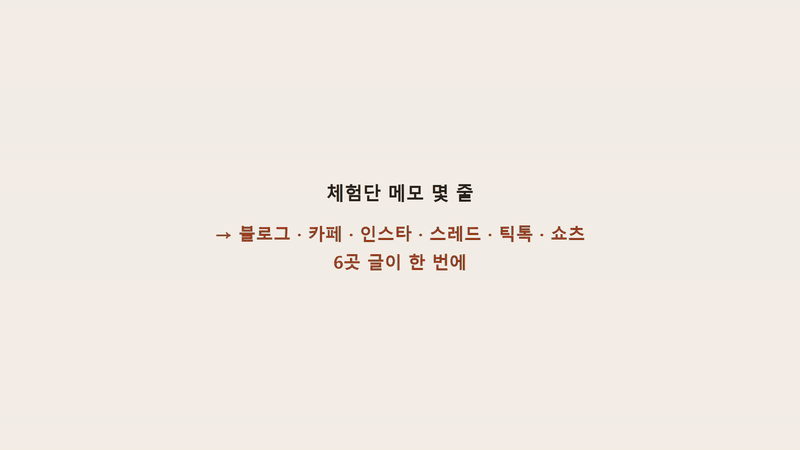
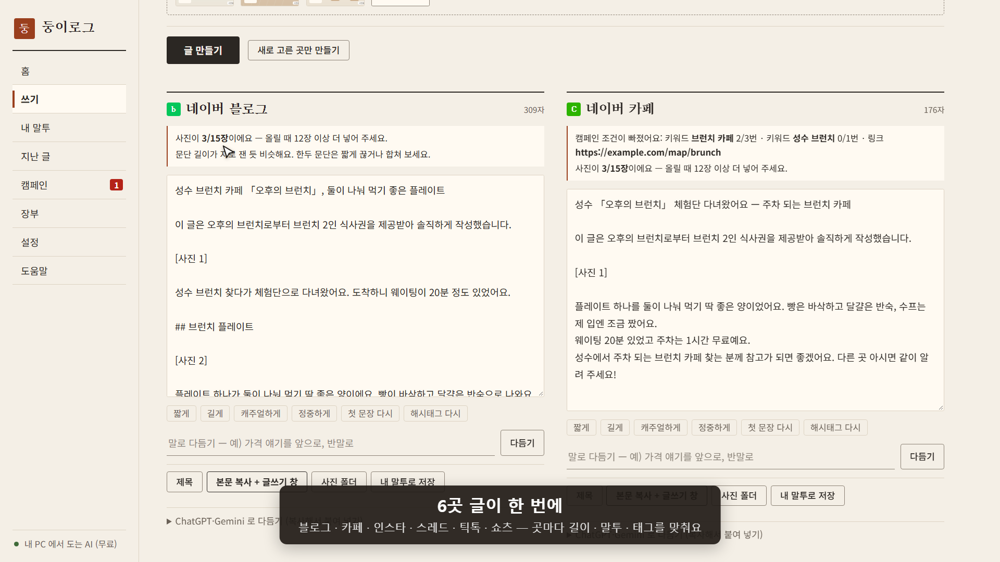
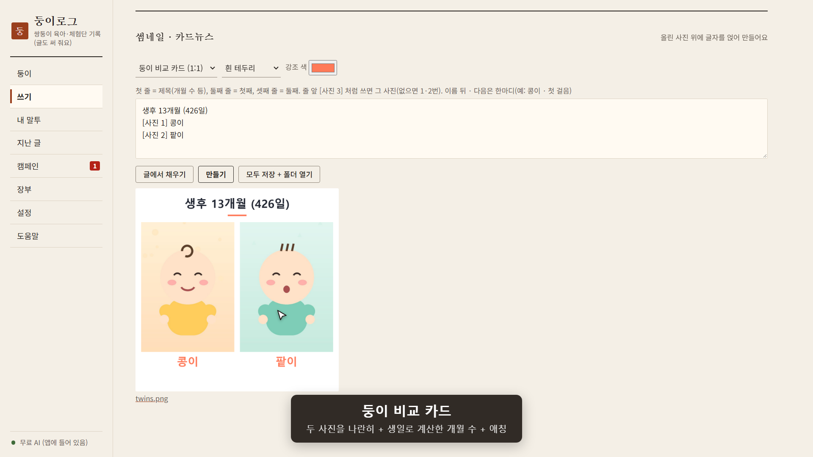
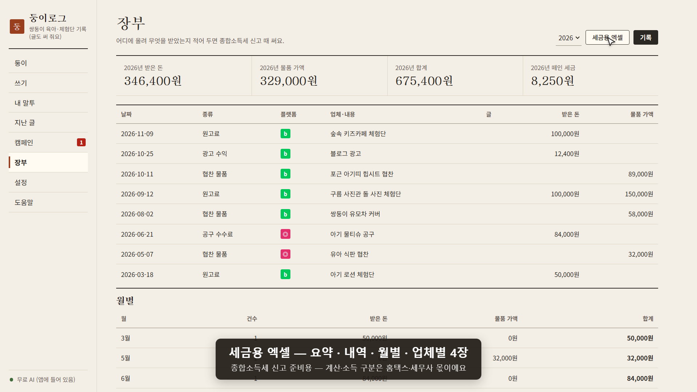

# DungiLog (둥이로그)

**One sponsored-review post, six platforms at once.** A Windows desktop app for Korean bloggers who do sponsored reviews (체험단·협찬): turn a few photos and a short memo into draft posts for six platforms in your own writing style, and keep campaign deadlines and payments in one place.

**Install:** download `DungiLog.exe` from [Releases](https://github.com/swbins/dungilog/releases/latest) (Windows 10/11, single file, no installer). winget: coming soon (submission pending review).

- **Six drafts at once** — Naver Blog, Naver Cafe, Instagram, Threads, TikTok, YouTube Shorts, with `[photo n]` placeholders
- **Sponsored-review tracking** — paste the brand's brief to fill required keywords, tags, links and deadlines; the disclosure line is added by the app
- **Income ledger** — payments and product values, Excel export for tax filing
- **Your voice** — learns sentence length, endings and emoji habits from a few of your own posts
- **"AI-ish" check without AI** — flags clichés, repeated endings and repeated emoji
- **Thumbnails, card news, disclosure banners** — plus optional parenting records (growth log, vaccination schedule, monthly album PDF)

Free. No API key — AI is optional (a bundled local model, or a Claude Code / Codex / Gemini CLI subscription you already have). Runs locally; photos and posts stay on your PC. No auto-posting or auto-login. The UI is in Korean.

[한국어 설명 ↓](#한국어)

---

## 한국어

**둥이로그 (DungiLog) — 체험단 글을 한 번에 6곳으로**

협찬 마감 놓친 적 있으세요? 체험단 하나를 하면 같은 이야기를 블로그 · 카페 · 인스타 · 스레드 · 틱톡 · 쇼츠에 맞게 따로 쓰고, 키워드와 마감, 받은 돈을 또 따로 챙겨야 합니다.
둥이로그는 메모 몇 줄과 사진으로 **6곳 글 초안을 한 번에, 내 말투로** 쓰고, 업체 안내문의 조건 · 마감 · 협찬 표기와 받은 돈 장부를 한곳에 모읍니다. **무료**이고, 내 PC 안에서만 돕니다.
육아 기록(아이 몇 명이든)은 설정에서 켜는 선택입니다. 처음엔 쌍둥이 부모용으로 만들어서 이름이 둥이로그예요.

## 받기

👉 **[최신 판 받기 (Releases)](https://github.com/swbins/dungilog/releases/latest)** — `DungiLog.exe` 하나, 설치 과정 없음

- **Windows 10 / 11** (Microsoft Edge — 기본으로 깔려 있음)
- 처음 실행할 때 **「Windows의 PC 보호」** 창이 뜰 수 있습니다. 코드 서명을 하지 않은 개인 앱이라 그렇습니다 —
  **「추가 정보」 → 「실행」** 을 누르면 열립니다. 걱정되면 아래 SHA256 값과 받은 파일을 비교하거나 [VirusTotal](https://www.virustotal.com/) 에 올려 보세요.
- 받은 파일 확인(PowerShell): `Get-FileHash .\DungiLog.exe` → 릴리스 노트의 SHA256 과 같으면 그대로 받은 것입니다.

## 할 수 있는 것

- **메모 · 사진 → 6곳 글 초안 한 번에** — 사진 자리 `[사진 1]` 까지 잡아 줌, 쇼츠는 제목 · 설명 · 태그 · 고정 댓글 네 칸, 말로 다듬기(「가격 얘기를 앞으로」)
- **체험단 · 협찬 · 공구** — 업체 안내문을 붙여 넣으면 필수 키워드 · 태그 · 링크 · 마감이 채워짐, 마감 D-day, 협찬 표기 문구는 앱이 넣음
- **장부** — 받은 돈 · 물품 가액 기록, 세금용 엑셀(종합소득세 신고 준비용)
- **내 말투** — 내가 쓴 글 몇 개로 문장 길이 · 끝맺음 · 이모지 습관을 따라 씀
- **AI 티 점검** — 뻔한 표현 · 같은 끝맺음 · 반복 이모지를 AI 없이 짚어 줌
- **썸네일 · 카드뉴스 · 협찬 표기 배너**
- **폰에서 쓰기** — 같은 와이파이에서 QR + 6자리 PIN
- **육아 기록(선택)** — 성장 기록 · 나란히 비교 카드 · 예방접종 일정 · 월간 앨범 PDF, 아이마다 생일로 개월 수 계산

## AI 는 고를 수 있어요

| 고르는 것 | 비용 | 글이 어디로 가나 |
|---|---|---|
| **내 PC 에서 도는 AI (무료)** — 기본 | 무료 | PC 밖으로 안 나감. 처음 한 번 모델(약 3~5GB)을 받습니다 |
| **AI 없이** | 무료 | 메모 틀로 글 초안까지(AI 를 안 받았으면 이것). ChatGPT · Gemini 에 붙여 넣어 다듬기도 |
| Claude Code · Codex · Gemini CLI | 각자 쓰는 구독 | **직접 골랐을 때만** 그 회사로 감 |

글은 **초안**입니다 — 올리기 전에 한 번 읽고 다듬어 주세요. 자동 올리기 · 자동 로그인은 하지 않습니다(네이버 약관).

## 내 데이터

모든 사진 · 글 · 아이 정보는 **내 PC 안**(`%APPDATA%\PostKit`)에만 있습니다. 계정 가입 · 사용 통계 · 광고가 없고, 만든 사람에게 아무것도 보내지 않습니다.
지우려면 실행 파일과 그 폴더를 지우면 됩니다.

- [개인정보 처리 안내](PRIVACY.md)
- [이용 약관](TERMS.md)
- [서드파티 고지 · 상표](THIRD-PARTY-NOTICES.md)

## 문의 · 버그 알리기

[Issues](https://github.com/swbins/dungilog/issues) 에 남겨 주세요. 아이 사진 · 실명은 올리지 마세요.

---

둥이로그는 개인이 만든 독립 앱으로, Anthropic · OpenAI · Google · NAVER · Meta · ByteDance 와 제휴 · 보증 관계가 없습니다.
이 저장소에는 실행 파일과 안내 문서만 있습니다(소스 비공개).
